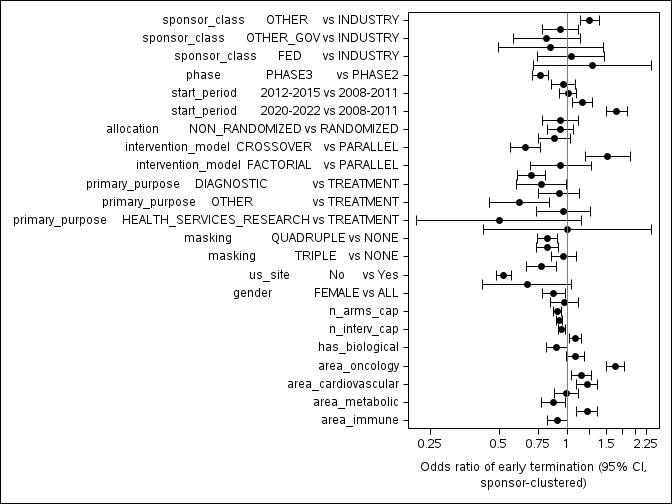
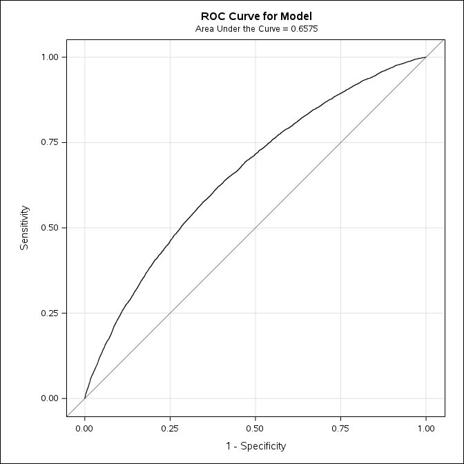
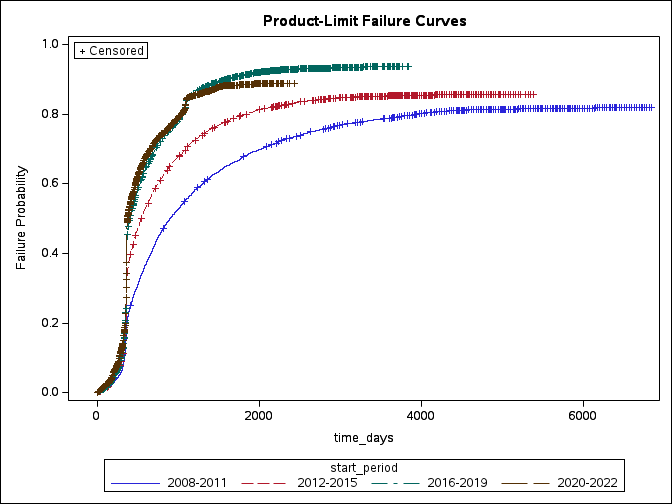
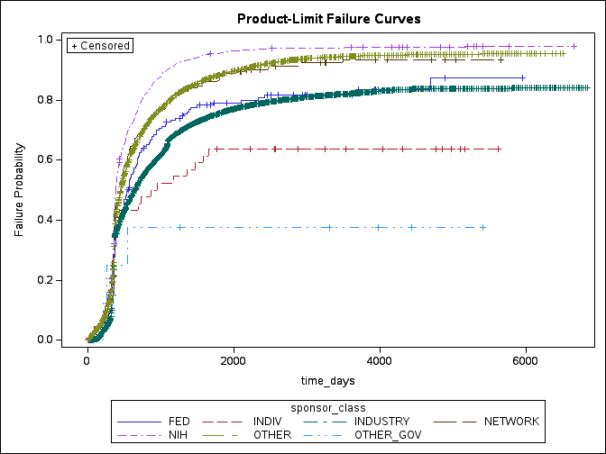

# AACT: predictors of early termination and results reporting in interventional drug trials

A reproducible SQL (PostgreSQL) and SAS analysis of ClinicalTrials.gov registry data from the AACT database, snapshot **2026-11-15**.

**Question:** What predicts early termination, and late or missing results reporting, among interventional Phase 2/3 drug trials?

> Results are descriptive associations, not causal effects. Related published analyses exist; this is an updated, reproducible analysis on a fixed snapshot, not a first-of-its-kind claim.

## Skills demonstrated

- **PostgreSQL:** scripted cohort flow with CTEs, window functions (`rank`, `ntile`, `lag`, rolling sums, `percentile_cont`), views, indexing, data quality checks, and a one-command pipeline (`run_all.sh`) with a saved log for every script.
- **SAS:** PROC SURVEYLOGISTIC with sponsor-clustered standard errors, PROC LOGISTIC (ROC and AUC), PROC LIFETEST (Kaplan-Meier, log-rank), PROC PHREG with robust variance, and ODS graphics.
- **Statistical practice:** a fixed data snapshot, documented cleaning rules with record counts, sensitivity analyses, a proportional-hazards check, and findings that are reported as not robust when they change between analyses.
- **Reproducibility and honesty:** a decisions log that records a corrected outcome definition, and limitations stated up front.

## Headline results

| Outcome | Population | Main finding |
|---|---|---|
| Early termination | 44,157 completed or terminated trials (7,734 terminated, 17.5%) | Oncology trials (OR 1.63) and trials started 2020-2022 (OR 1.66 vs 2008-2011) are terminated more often; Phase 3 (OR 0.76), crossover designs (OR 0.66) and trials without a US site (OR 0.53) less often. Modest discrimination (AUC 0.658), good calibration (Hosmer-Lemeshow p = 0.92). |
| Late or missing results (> 12 months or never) | 22,346 likely-applicable trials with at least 12 months of follow-up (64.8% late) | Strong improvement over time (OR 0.24 for 2020-2022 vs 2008-2011), and with multi-country trials (OR 0.51 per log-country unit), NIH-sponsored trials (OR 0.37 vs industry) and "other" sponsors (OR 0.52). AUC 0.712. Termination is not associated with lateness (OR 0.96, CI 0.87-1.07). |
| Time to results submission | 22,668 likely-applicable trials | Share submitting within 12 months rose from 20% (2008-2011 starts) to 48% (2020-2022 starts); median time fell from 896 to 371 days. |

### Early termination



Odds ratios from logistic regression with sponsor-clustered robust standard errors (thousands of sponsors; reference level is the most frequent category). Full table: [`output/termination_odds_ratios.csv`](output/termination_odds_ratios.csv). Enrollment is deliberately excluded: AACT stores the actual count, which is a consequence of termination (terminated trials have a median of 24 participants against 100 for completed ones).

Sensitivity analyses (same CSV):
- **Start year <= 2018** (guards against recent trials being resolved selectively): oncology (1.60), crossover (0.63), Phase 3 (0.78) and no US site (0.56) are stable.
- **Withdrawn trials counted as early stops:** the 2020-2022 effect grows (OR 2.12). Trials with unknown US-site status become much more likely to count as stopped (OR 3.16), probably because withdrawn trials rarely list any facility.
- **Not robust:** the number-of-countries effect (1.09 in the main model, 1.03 with start year <= 2018, 1.00 with withdrawn counted) and the infectious-disease effect (0.99, then 0.78) change between analyses, so they are not reported as findings.



### Results reporting

US law requires results to be submitted within 12 months of primary completion. "Likely applicable" means a US facility and not marked non-FDA-regulated (the proxy is described in [`docs/decisions.md`](docs/decisions.md)).



| Start period | Submitted within 12 months | Median days to submission |
|---|---|---|
| 2008-2011 | 20% | 896 |
| 2012-2015 | 33% | 543 |
| 2016-2019 | 44% | 402 |
| 2020-2022 | 48% | 371 |

Log-rank tests across start periods (chi-square 1,617) and sponsor classes (965) both give p < 0.0001. Submission by sponsor class at 12 months: NIH 44%, other 36%, industry 34%, federal 28%. Curves for individual and other-government sponsors rest on very few trials (about 8 for other-government) and are not interpretable.



The Cox model (sponsor-clustered robust variance) and the late-reporting logistic model are in [`output/cox_hazard_ratios.csv`](output/cox_hazard_ratios.csv) and [`output/late_odds_ratios.csv`](output/late_odds_ratios.csv). Hazard ratios above 1 mean faster submission.

**Proportional hazards does not hold.** The resampling test rejects it (see [`output/ph_check_sponsor_class_other.png`](output/ph_check_sponsor_class_other.png)), and the model fitted separately before and after one year shows why: effects are largest around the deadline.

| Covariate | HR, first 365 days | HR, after 365 days |
|---|---|---|
| Start 2020-2022 vs 2008-2011 | 2.79 | 1.99 |
| log(1 + countries) | 1.60 | 1.23 |
| NIH vs industry | 2.12 | 3.22 |
| Other sponsor vs industry | 1.70 | 2.24 |
| Terminated vs completed | 1.07 | 0.81 |

Overall hazard ratios are therefore averages over follow-up. The deadline-aligned late-reporting model is not affected by this, which is why it is the main reporting result. Full table: [`output/cox_hr_by_window.csv`](output/cox_hr_by_window.csv). Among all trials with at least 12 months of follow-up, "other" sponsors look worse than industry (84% late vs 70%), but after adjustment for start period and country count they are less likely to be late (OR 0.52): the crude and adjusted pictures differ.

## Cohort

Interventional trials, Phase 2, Phase 2/3 or Phase 3, with at least one drug or biological intervention, started 2008-2022, final status completed, terminated or withdrawn.

| Step | Trials |
|---|---|
| Registered studies | 611,764 |
| Interventional | 466,855 |
| Phase 2, 2/3 or 3 | 116,384 |
| With a drug or biological intervention | 102,981 |
| With a start date | 102,005 |
| Started 2008-2022 | 60,840 |
| Completed, terminated or withdrawn | 46,801 |
| Termination model (withdrawn and unknown sponsor excluded) | 44,157 |
| Reporting dataset (date-inconsistent and unknown-sponsor trials excluded) | 43,975 |

Cleaning rules and counts are in [`docs/decisions.md`](docs/decisions.md).

## Methods in brief

- **Early termination:** terminated vs completed. Withdrawn trials never enrolled, so they appear only in a sensitivity analysis.
- **Late reporting:** results first *submitted* more than 12 months after primary completion, or never, among trials with at least 12 months of follow-up. The submission date is used rather than the posting date because the legal deadline is for submission (posting lags by review time). The submission-based timing agrees with AACT's own `months_to_report_results` field (mean absolute difference 0.34 months).
- **Time to submission:** Kaplan-Meier (shown as cumulative submission) and Cox regression; trials without submission are censored at the snapshot date.
- **Clustering:** trials from the same sponsor are not independent (termination ranges from 0.7% to 34% across large sponsors), so all models use sponsor-clustered standard errors.

## Limitations

- Associations in registry data; there is no randomisation and no adjustment for unobserved factors such as drug class, trial cost or safety signals.
- Termination odds ratios describe resolved trials only; recent trials resolve selectively (short trials and early stops first), which is why the start-year effect is checked in a sensitivity analysis.
- The "likely applicable" flag is a proxy, not a legal determination: `is_fda_regulated_drug` is missing for 54.6% of trials, so a missing value is treated as possibly applicable.
- Therapeutic-area flags come from MeSH condition terms and can overlap.
- Discrimination for termination is modest (AUC 0.66); the model describes patterns, it is not a screening tool.

## Reproducing

1. **Get the data.** Download the PostgreSQL dump from https://aact.ctti-clinicaltrials.org/downloads and restore the 14 study-level tables listed in `docs/decisions.md` into a local database `aact` (schema `ctgov`). AACT refreshes daily and its downloads page offers the latest snapshot; older static copies are listed on AACT's archive page, and monthly copies of the pipe-delimited export are also deposited on Zenodo. A snapshot other than 2026-11-15 will give somewhat different counts and estimates, because registrations and results keep being added. To confirm you have the same data, check that `SELECT count(*) FROM ctgov.studies` returns 611,764 and that the cohort flow in `logs/01.log` matches the table below.
2. **Run all SQL:** `bash run_all.sh` (asks for the Postgres password once, writes logs to `logs/`, exports the three model datasets to `output/`).
3. **Run SAS:** upload `output/model_*.csv` and `sas/*.sas` to a SAS OnDemand for Academics folder named `aact`, then run in order: `01_prepare.sas`, `02_termination.sas`, `03_reporting.sas`, and optionally `03b_ph_check.sas`.

Database used: PostgreSQL 18 on macOS. Results in this repository were produced by one run of this pipeline on the 2026-11-15 snapshot.

## Structure

```
sql/      numbered scripts: indexes, cohort, features, window analyses, quality checks, analysis datasets
sas/      01 prepare, 02 termination model, 03 reporting models, 03b proportional-hazards check
output/   figures and result tables (trial-level model inputs are not committed)
logs/     saved query logs
docs/     decisions, definitions and cleaning rules
```

Raw data and dumps are not stored in this repository.

## License and data

Code is released under the [MIT License](LICENSE). The analysis uses public ClinicalTrials.gov registry data distributed by AACT (CTTI); no registry data are redistributed here, only aggregate results.
